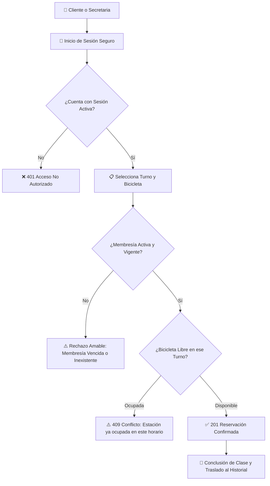

# 🚴 Sistema de Gestión de Gimnasio & Clases de Spinning

> **Solución Backend empresarial desarrollada con .NET 8, C# y Entity Framework Core** para la administración integral de estudios de *indoor cycling*, control de aforo por turnos, membresías y reservaciones en tiempo real.

---

## 🌟 Propósito y Valor de Negocio

En los centros de entrenamiento y estudios de spinning modernos, los mayores dolores de cabeza operativos son el **sobrecupo de bicicletas**, las **reservaciones duplicadas**, clientes intentando reservar sin membresía al día y la falta de control en los turnos de clase.

Este sistema resuelve esa problemática mediante una **arquitectura de software limpia y confiable** que automatiza el ciclo completo del negocio:

1. **Gestión de Membresías:** Valida al instante que el cliente tenga una suscripción activa y vigente antes de permitirle apartar un lugar.
2. **Asignación Inteligente de Bicicletas por Horario:** Permite que una misma estación sea utilizada en distintos turnos del día, garantizando que nadie pueda apartar una bicicleta ya ocupada en una misma hora.
3. **Roles y Privilegios Claros:** Separa las facultades del personal administrativo (secretaría) de las acciones de los clientes, cuidando en todo momento la privacidad de los datos.
4. **Historial de Asistencia:** Registra el ciclo de vida de cada clase desde que se aparta hasta que concluye, dejando una bitácora transparente de asistencia.

---

## 🧭 Flujo Operativo del Negocio

El siguiente diagrama ilustra cómo el sistema coordina cada solicitud para asegurar una operación libre de conflictos:

---

## 💎 Pilares de Calidad y Experiencia de Integración

### 📖 1. Documentación Viva y Amigable (Swagger / OpenAPI)
Diseñada para que cualquier integrante de un equipo (reclutadores, desarrolladores frontend, gerentes o evaluadores técnicos) entienda de inmediato el propósito de cada función:
- **Descripciones en lenguaje claro y accesible:** Sin tecnicismos que confundan al lector.
- **Respuestas transparentes:** Cada acción detalla exactamente qué sucede en caso de éxito y cómo avisa amablemente si ocurrió un dato incompleto, una bicicleta ocupada o una membresía vencida.
- **Autorización con un solo clic:** Permite ingresar la clave de acceso directamente en la interfaz visual para probar cualquier función protegida.

### 🛡️ 2. Seguridad y Privacidad desde el Diseño
- **Contraseñas Cifradas:** Uso del estándar criptográfico PBKDF2 (HMAC-SHA256 con 100,000 iteraciones y sal aleatoria) para salvaguardar las credenciales de los clientes.
- **Protección de Datos Sensibles:** La API utiliza modelos de transferencia (DTOs) diseñados para no filtrar jamás contraseñas ni llaves de sesión en las consultas públicas.
- **Sesiones Controladas:** Las claves de acceso se invalidan de forma segura al momento de cerrar sesión.

### 🛡️ 3. Manejo Amable de Errores Inesperados
El sistema cuenta con un filtro central de excepciones. Si llegase a ocurrir un inconveniente imprevisto en el servidor, el usuario nunca verá pantallas rojas ni mensajes crípticos de código; en su lugar, la API responde con un mensaje cordial y ordenado en formato JSON que explica la situación.

### 🌱 4. Ecosistema de Prueba Listo para Usar
Para facilitar la evaluación inmediata del proyecto, el sistema incluye una precarga automática con un catálogo base:
- **15 Estaciones de spinning** identificadas individualmente y listas para reservarse.
- **8 Horarios de clases programados** distribuidos en la mañana y en la tarde.
- **Cuentas demostrativas listas** con sus respectivos roles y membresía al día:

| Rol | Correo Electrónico | Contraseña | Alcance y Facultades |
|---|---|---|---|
| **Secretaria / Admin** | `secretaria@gimnasio.com` | `Secretaria123!` | Administrar horarios, inventario de bicicletas, usuarios, activación de membresías y conclusión de clases. |
| **Cliente** | `cliente@gimnasio.com` | `Cliente123!` | Consultar disponibilidad de turnos, revisar el estado de su membresía y apartar o cancelar su propia bicicleta. |

---

## 📦 Módulos Funcionales del Sistema

| Módulo | Responsabilidad de Negocio | Beneficio para el Gimnasio |
|---|---|---|
| **👥 Usuarios y Accesos** | Registro de nuevos clientes, inicio de sesión seguro, perfiles y cierre de sesión. | Centraliza la cartera de socios y garantiza que solo usuarios autenticados reserven. |
| **💳 Membresías** | Control de suscripciones mensuales, renovación y detección automática de membresías vencidas. | Evita pérdidas económicas asegurando que solo asistan clientes con su pago al corriente. |
| **🚴 Bicicletas** | Inventario de estaciones, control de mantenimiento y consulta de disponibilidad por horario. | Conoce el estado físico de cada bicicleta y optimiza el cupo de cada sala. |
| **⏰ Horarios** | Definición de los turnos de clase matutinos y vespertinos. | Establece una cartelera ordenada y previene choques de agenda. |
| **🎟️ Reservaciones & Historial** | Motor central de reservaciones, validación de cupo en tiempo real y pase a historial finalizado. | Cero duplicados, control de talla de calzado/bicicleta y seguimiento de asistencia. |

---

## 🎯 Por qué este proyecto destaca

* **Enfoque Centrado en el Negocio:** Más allá de un CRUD tradicional, implementa reglas reales: validación cruzada de membresía activa, control de aforo por turno y protección contra doble reserva simultánea.
* **Código Limpio y Mantenible:** Separación estricta de responsabilidades entre entidades de base de datos, modelos de transferencia (DTOs) y controladores orientados a tareas.
* **Listo para Integrar con Frontend:** Respuestas HTTP estándar (`200 OK`, `201 Created`, `400 Bad Request`, `401 Unauthorized`, `403 Forbidden`, `404 Not Found`, `409 Conflict`) que facilitan la vida a los desarrolladores de interfaces web y móviles.
